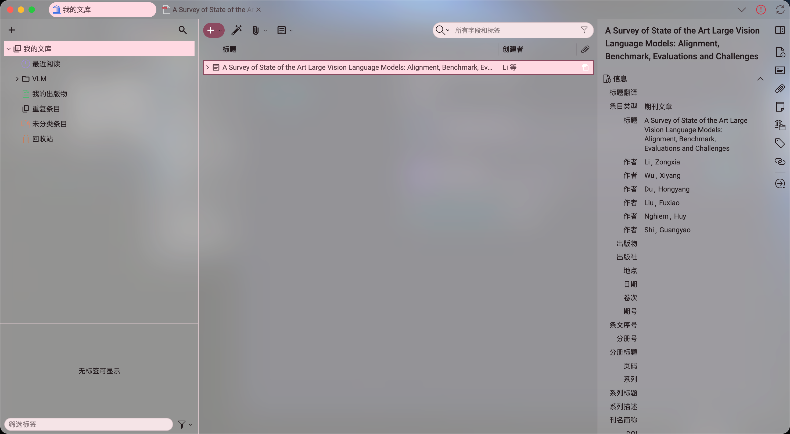
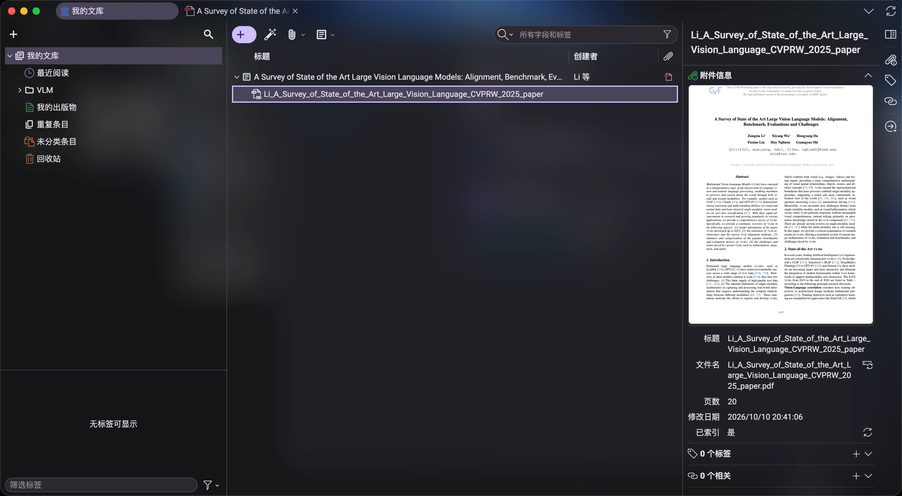
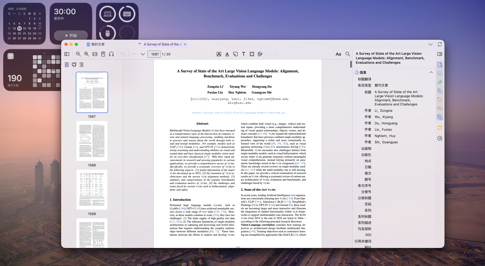
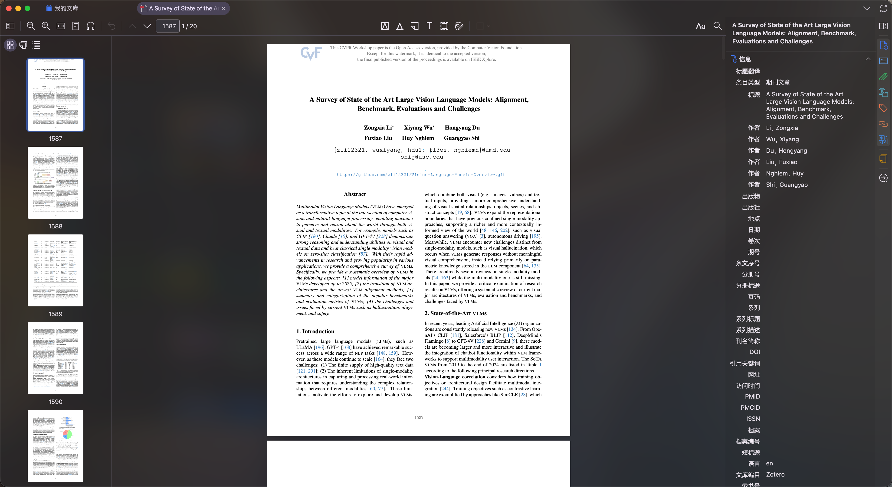
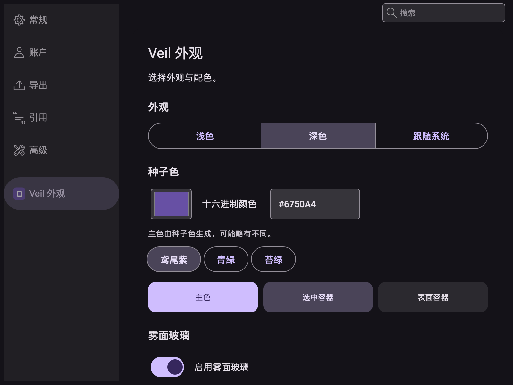
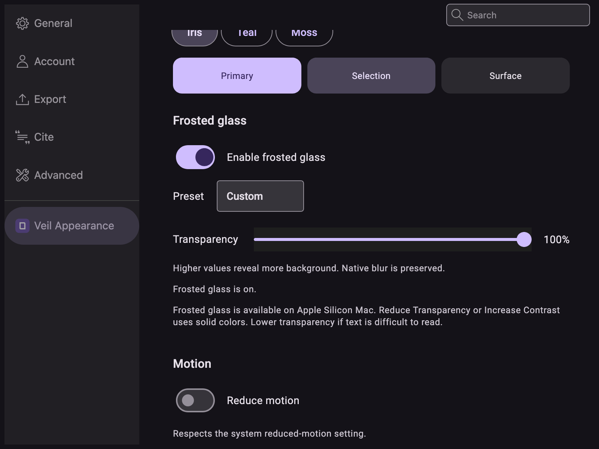

<div align="center">


# Zotero Veil

Material colors and frosted glass for Zotero on macOS.

[简体中文](README.md) · [English](README.en.md)

[](LICENSE)
[](https://github.com/LiuAoran/zotero-veil/stargazers)


[**下载 XPI**](https://github.com/LiuAoran/zotero-veil/blob/main/downloads/zotero-veil-1.0.4.xpi)

[外观](#外观) · [安装](#安装) · [功能](#功能) · [兼容与限制](#兼容与限制) · [开发](#开发)

</div>

---

面向 macOS Zotero 10 的 Material 配色与柔和磨砂主题。保留 Zotero 原有快捷键、文献操作、列宽调整和面板缩放。

## 外观

以下为 macOS 实机截图，效果会随桌面背景、种子色和通透度变化。

### 浅色文献库



### 深色文献库



<details>
<summary>阅读器与外观设置</summary>

**浅色阅读器**



**深色阅读器**



**外观设置**





</details>

## 安装

[前往下载目录](https://github.com/LiuAoran/zotero-veil/blob/main/downloads/zotero-veil-1.0.4.xpi)，打开 XPI 文件并选择 Download raw file。

1. 在 Zotero 的“工具 → 插件”中选择“从文件安装插件”。
2. 安装 XPI 文件。
3. 打开“设置 → Veil 外观”，调整外观与配色。

设置即时生效并自动保存。禁用插件可恢复原界面，主题偏好会保留。

## 语言

Veil 跟随 Zotero 的界面语言：中文显示简体中文，其他语言使用英文。仅翻译 Veil 自己的设置、提示和无障碍标签，不修改 Zotero、系统或其他插件语言。改变 Zotero 语言后，按 Zotero 提示重启。

## 功能

- 浅色、深色、跟随系统。
- 自定义种子色与三个配色预设，使用官方 Material Color Utilities 生成语义配色。
- 文库导航、搜索、文献列表、详情面板和阅读器工具栏的统一外观。
- Apple Silicon Mac 原生雾面玻璃，可用滑动条调整附加色层，最高档保留10%色层；保留全强度原生模糊和轻微侧栏色差。
- 保留选中、焦点及编辑状态，支持减少动态效果。
- PDF 页外背景透明，纸张、标注、文献数据和笔记内容不变。

## 兼容与限制

支持 Zotero 10.0.*，实机检查环境为 Zotero 10.0.6。原生雾面玻璃目前仅在 Apple Silicon macOS 验证。其他平台待测试；代码会在原生材质不可用或系统“减少透明度／增强对比度”开启时回退实色，但这不代表其他平台已通过兼容性验证。

雾面玻璃是 Material 配色与 macOS 材质的融合扩展，不属于官方 Material Design 3 组件。高通透度在复杂背景下不保证文字对比度，阅读不清时请降低数值。系统菜单、PDF 页面、笔记编辑器和第三方插件区域保留原有外观。独立阅读器窗口、Intel／Rosetta、VoiceOver 和其他插件组合尚未完整验证。

无可用的自动更新服务，升级请手动安装 XPI。设置窗口和内容截图检查不等于桌面背景动态磨砂已验证。详见[验证说明](docs/验证说明.md)。

## 开发

需要 Node.js 22 或更新版本、npm 和 Python 3：

```sh
npm ci --ignore-scripts
npm test
npm run build
python3 scripts/package-source.py
```

安装包和源码包生成在 `dist/`。目录说明：

- `addon/`：插件入口、设置、样式与资源。
- `src/`：配色、材质、生命周期与阅读器适配。
- `tests/`：自动测试和隔离运行测试。
- `scripts/`：构建、打包和隔离测试工具。
- `licenses/`：依赖、字体与图标的许可证。

测试应使用独立临时配置，操作方法见[测试指南](docs/测试指南.md)。生产安装包不包含测试桥。请勿将测试桥装入日常 Zotero。

## 许可证

本项目采用 [MIT](LICENSE) 许可证。第三方组件的许可证与归属见 [licenses/](licenses/NOTICE.md)。
